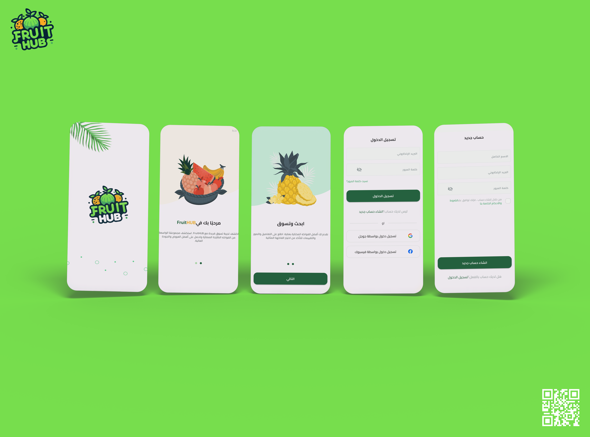
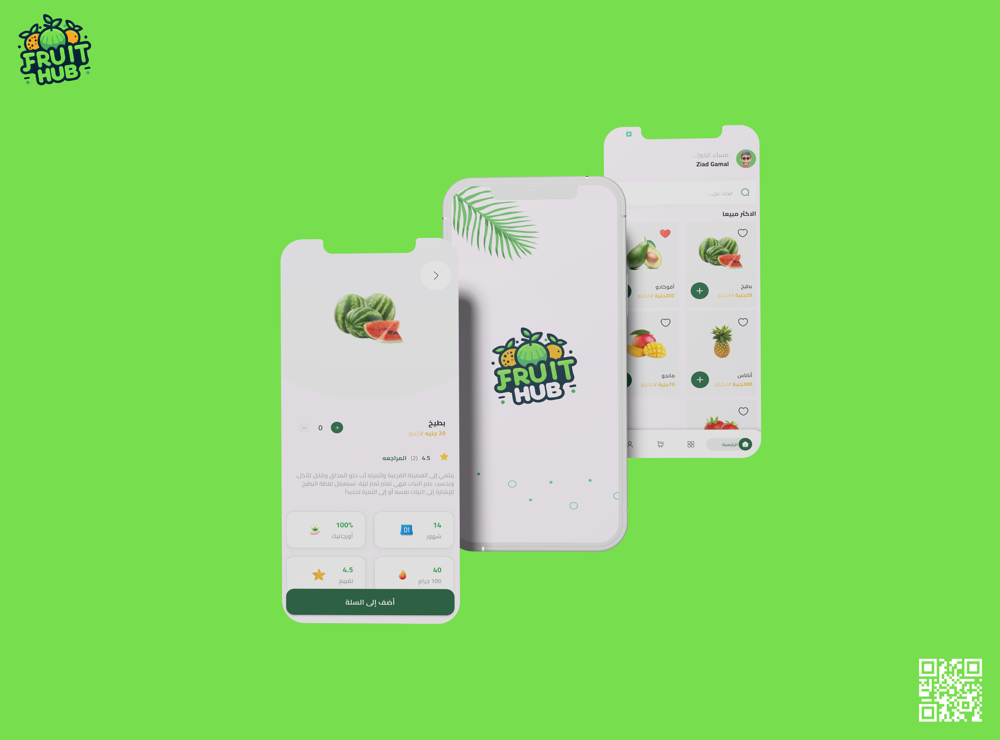
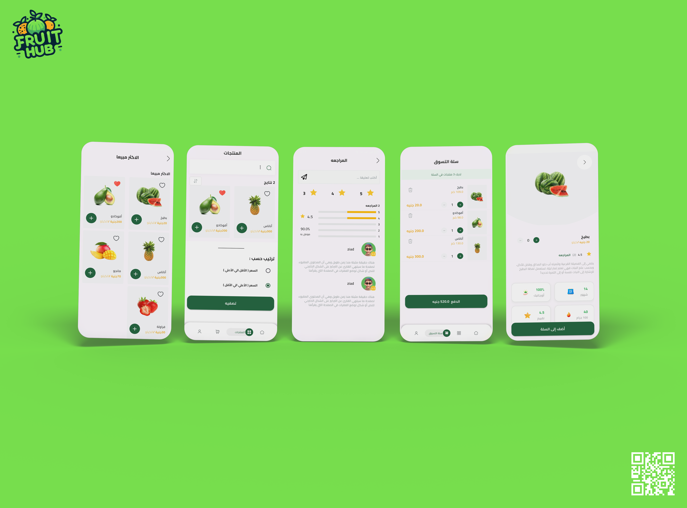
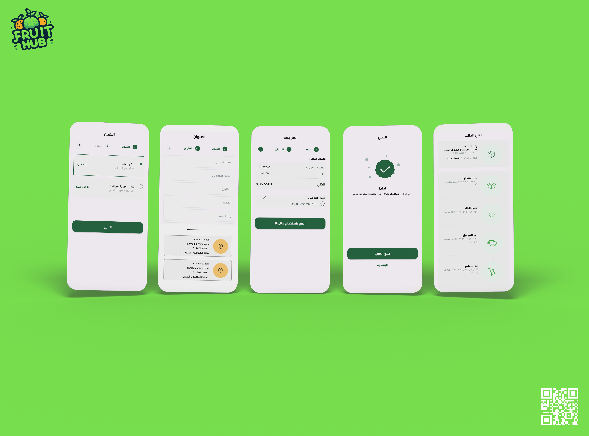
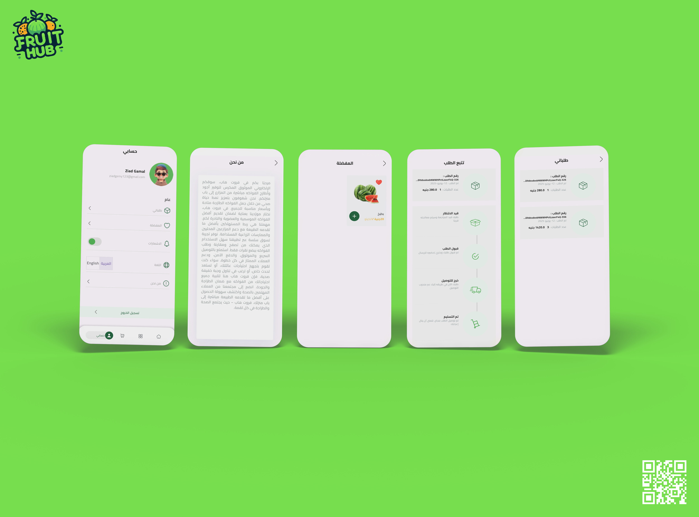

# FruitHub — Fresh Grocery & Fruit E-Commerce App

**A cross-platform Flutter e-commerce application for discovering fresh fruits, managing carts and wishlists, completing multi-step checkouts via PayPal or Cash on Delivery, and tracking real-time order statuses.**

  
  
  
  
  
  

[**Watch Demo Video**](ScreenShots/DemoVideo/demoVideo.mp4) · [**Key Features**](#-key-features) · [**Architecture**](#-architecture) · [**Getting Started**](#-getting-started)

## 📖 Overview

**FruitHub** (`fruits`) is a full-featured mobile e-commerce application built with Flutter that delivers a smooth, bilingual shopping experience for fresh produce. From onboarding and social sign-in to browsing best-selling fruits, managing favorites, and checking out with PayPal, the app is designed around a modular, feature-first architecture.

- **17 Routed Screens Across 10 Feature Modules:** Covers the complete shopping journey—from onboarding and product discovery to multi-step checkout, order confirmation, and live order tracking.
- **Dual Payment Workflows (`PayPal` & `Cash`):** Integrates `flutter_paypal_payment` for online sandbox transactions alongside Cash on Delivery, with automatic Firestore order persistence and real-time product stock/sales-count updates.
- **Bilingual & Offline-Ready UX:** Ships with full **Arabic (RTL) and English** localization (`l10n`) and fast local caching via `SharedPreferences` for user sessions, saved shipping addresses, language preferences, and onboarding state.

## 🎥 Demo Video & Screenshots

> 🎬 **[Click here to watch or download the full app walkthrough (`ScreenShots/DemoVideo/demoVideo.mp4`)](ScreenShots/DemoVideo/demoVideo.mp4)**

| Splash, Onboarding & Authentication | Home Feed & Product Details |
| :---: | :---: |
|  |  |

| Cart, Search & Product Reviews | Multi-Step Checkout & Ordering |
| :---: | :---: |
|  |  |

| User Profile, Orders & Settings |
| :---: |
|  |

## ✨ Key Features

- **Interactive Onboarding (`Splash`, `Onboarding`):** Multi-page walkthrough (`dots_indicator`, `smooth_page_indicator`) that introduces core store features and persists completion state in `SharedPreferences` (`KIsonboaringseen`).
- **Multi-Provider Authentication (`Auth`):** Sign in or register via **Email & Password**, **Google** (`google_sign_in`), **Facebook** (`flutter_facebook_auth`), or **Apple** (`sign_in_with_apple`), complete with password reset (`CustomResetPasswordView`) and terms acceptance.
- **Product Discovery, Search & Best Sellers (`Home`, `products`, `BestSeller`):** Browse featured offers, best-selling fruits (`bestSellerView`), and filtered product grids (`Productsview_Body`) with skeleton loading states (`skeletonizer`).
- **Rich Product Details & Reviews:** Inspect detailed fruit descriptions, pricing, unit weights, nutritional highlights, and customer ratings/reviews (`Productdetailsview`, `ProductreviewsView`).
- **Reactive Cart & Favorites (`Cart`, `favorite_products_cubit`):** Manage cart items and quantities in real time via `CartCubit` (`Cartentity`), and save favorite fruits directly to Firestore's `users/{uid}/favourites` subcollection (`Myfavoriteproductsview`).
- **Multi-Step Checkout & Saved Addresses (`CheckOut`):** Step-by-step checkout orchestrated by `ProccessStepsCubit`, supporting shipping selection, reusable shipping addresses cached in `SharedPreferences`, and a detailed order summary (`Ordersummaryviewbody`).
- **PayPal & Cash on Delivery Integration:** Pay online via **PayPal** (`AddOrderCubit.paywithPaypal()`) or choose **Cash on Delivery** (`AddOrderCubit.addOrder()`). Confirmed orders automatically decrement product inventory (`amout`) and increment `sellingCount` in Firestore.
- **Order History & Live Order Tracking (`OrderTraking`, `MyOrdersView`):** Review historical purchases and track active order progress step by step (`Ordertrakingview`).
- **Profile, Localization & Notifications (`Profile`):** Update account information, switch dynamically between **Arabic (`ar`)** and **English (`en`)**, manage local notifications (`LocalNotifications`), and view About Us & Terms (`Aboutusview`, `Termsandconditionsview`).

## 🛠 Tech Stack

| Category | Packages & Technologies |
| :--- | :--- |
| **Framework & SDK** | Flutter (Android, iOS, Web, Desktop scaffolding), Dart `>=3.4.1 <4.0.0` |
| **State Management** | `flutter_bloc ^9.1.1`, `provider ^6.1.2`, `rxdart ^0.28.0` |
| **Dependency Injection** | `get_it ^7.7.0` |
| **Navigation & Routing** | `Navigator` with centralized `onGenerateRoute` (`OnGenrateRoute.dart`, 17 routes) |
| **Backend & Cloud** | `firebase_core ^3.2.0`, `firebase_auth ^5.1.2`, `cloud_firestore ^5.2.1`, `supabase_flutter ^2.8.1` |
| **Payments** | `flutter_paypal_payment ^1.0.8` (PayPal Sandbox Checkout + Cash on Delivery) |
| **Social Auth & Security** | `google_sign_in ^6.2.1`, `flutter_facebook_auth ^7.0.1`, `sign_in_with_apple ^6.1.1`, `crypto ^3.0.3` |
| **UI, Animations & Media** | `flutter_animate ^4.5.2`, `skeletonizer ^2.0.1`, `awesome_dialog ^3.2.1`, `cached_network_image ^3.4.1`, `flutter_svg ^2.1.0`, `svg_flutter ^0.0.1`, `dots_indicator ^3.0.0`, `smooth_page_indicator ^1.2.0+3`, `modal_progress_hud_nsn ^0.5.1`, `font_awesome_flutter ^10.7.0` |
| **Local Persistence** | `shared_preferences ^2.2.3` |
| **Localization & Functional** | `flutter_localizations`, `intl` (Arabic & English ARB files), `dartz ^0.10.1`, `equatable ^2.0.7` |
| **Dev & Testing** | `flutter_test`, `flutter_lints ^3.0.0`, `flutter_launcher_icons ^0.13.1` |

## 🏗 Architecture

FruitHub is built around a **feature-first Clean Architecture** pattern (`data`, `domain`, `presentation`) combined with **BLoC / Cubit** state management and **GetIt** dependency injection (`setup_Getit()`). Shared domain entities (including `paypal_payment_entity`), cross-feature repositories (`Products`, `Orders`), and Firebase services are centralized under `lib/core/`.

~~~mermaid
flowchart LR
    UI[Presentation Layer Checkoutview & Ordersummaryviewbody] --> Cubit[State Management CartCubit / ProccessStepsCubit / AddOrderCubit]
    Cubit --> PayPal[(PayPal Checkout flutter_paypal_payment)]
    Cubit --> Repo[Core Repositories OrdersrepoImpl & ProductsRepo]
    Repo --> FS[(Cloud Firestore orders & products)]
    Cubit --> Prefs[(SharedPreferences Saved Shipping Addresses)]
~~~

### Example Workflow: Multi-Step Checkout, PayPal Payment & Inventory Sync
1. **Cart State:** `CartCubit` maintains the active `Cartentity` in memory and passes it to `Checkoutview`.
2. **Checkout Progression:** `ProccessStepsCubit` manages the multi-step wizard (shipping option, shipping address selection/persistence in `SharedPreferences`, and payment review).
3. **Payment Execution:** In `Ordersummaryviewbody`, selecting online payment triggers `AddOrderCubit.paywithPaypal()` (launching `flutter_paypal_payment`), while Cash on Delivery invokes `AddOrderCubit.addOrder()` directly.
4. **Order Persistence & Stock Update:** Upon confirmation, `OrdersrepoImpl.addOrder()` writes the serialized `Ordermodel` (`"Online"` or `"Cash"`) to Firestore's `orders` collection, and `AddOrderCubit` updates the purchased items' stock (`amout`) and `sellingCount` in the `products` collection before navigating to `AddrOderSuccessView`.

### Folder Structure

~~~text
lib/
├── core/
│   ├── Entities/
│   │   └── paypal_payment_entity/       # PayPal transaction and item domain entities
│   ├── Helper_Funcitions/               # OnGenrateRoute.dart and UI/validation helpers
│   ├── Models/                          # Shared data models and serialization
│   ├── Repos/
│   │   ├── Orders/                      # Order repository contract and Firestore implementation
│   │   └── Products/                    # Product repository contract and Firestore implementation
│   ├── Utils/                           # Backend_EndPoints.dart, app colors, and text styles
│   ├── errors/                          # Failure classes and Firebase exception handling
│   ├── managers/
│   │   ├── Custom_reset_password_cubit/ # Password reset state management
│   │   └── favorite_products_cubit/     # Wishlist sync with Firestore favourites subcollection
│   ├── services/                        # FirebaseAuth, Firestore, SharedPreferences, LocalNotifications, GetIt
│   └── widgets/                         # Reusable buttons, app bars, and product cards
├── features/
│   ├── Auth/
│   │   ├── data/
│   │   ├── domain/
│   │   └── presentation/
│   ├── BestSeller/
│   │   ├── data/
│   │   ├── domain/
│   │   └── Presentation/
│   ├── Cart/
│   │   ├── domain/
│   │   └── presentation/
│   ├── CheckOut/
│   │   ├── data/
│   │   ├── domain/
│   │   └── presentation/
│   ├── Home/
│   │   ├── Domain/
│   │   └── Presentation/
│   ├── Onboarding/
│   │   └── presentation/
│   ├── OrderTraking/
│   │   ├── domain/
│   │   └── presentation/
│   ├── Profile/
│   │   ├── data/
│   │   ├── domain/
│   │   └── presentation/
│   ├── Splash/
│   │   └── presentation/
│   └── products/
│       └── presentation/
├── generated/                           # Auto-generated localization classes
├── l10n/                                # intl_ar.arb and intl_en.arb translation files
├── constent.dart                        # App constants and public configuration keys
├── firebase_options.dart                # Platform-specific Firebase options
└── main.dart                            # Application entry point and multi-provider bootstrap
~~~

## 🧭 Navigation & Route Table (`onGenerateRoute`)

Defined in `lib/core/Helper_Funcitions/OnGenrateRoute.dart`, the app manages **17 named routes** with strongly typed route arguments:

| Route Name | Screen Widget | Arguments Passed |
| :--- | :--- | :--- |
| `splash` | `Splash_View` | `None` |
| `onboardingView` | `onboardingView` | `None` |
| `LoginView` | `SignIn_View` | `None` |
| `signupView` | `signupview` | `None` |
| `/teacherResetPasswordView` | `CustomResetPasswordView` | `None` |
| `homeView` | `Homeview` | `None` |
| `bestSellerView` | `bestSellerView` | `None` |
| `/productdetailsview` | `Productdetailsview` | `Productsentity` |
| `/Productreviews` | `ProductreviewsView` | `Productsentity` |
| `Cartview` | `Cartview` | `None` |
| `checkout` | `Checkoutview` | `Cartentity` |
| `/AddOrderSuccessView` | `AddrOderSuccessView` | `Orderentity` |
| `/Ordertrakingview` | `Ordertrakingview` | `Orderentity` |
| `/MyOrdersView` | `MyOrdersView` | `None` |
| `/Myfavoriteproductsview` | `Myfavoriteproductsview` | `None` |
| `/aboutusview` | `Aboutusview` | `None` |
| `/Termsandconditionsview` | `Termsandconditionsview` | `None` |

## ☁️ Backend & Local Persistence

### Cloud Firestore Schema (`Backend_EndPoints.dart`)
| Firestore Path | Purpose |
| :--- | :--- |
| `products` | Product catalog, search, pricing, stock (`amout`), and `sellingCount` updates |
| `users` | Customer profile records and account metadata |
| `users/{uid}/favourites` | User-specific favorite products keyed by product code |
| `orders` | Submitted customer orders, shipping details, line items, and payment method (`Online` / `Cash`) |

### Local Storage (`SharedPreferences`)
Initialized at app startup via `shared_preferences_Services.init()` to persist:
- `userData` — Cached customer profile JSON for instant session restoration
- `shippingAddresses` — Serialized list of saved customer delivery addresses
- `languageCode` — Active locale preference (`ar` or `en`)
- `KIsonboaringseen` — Boolean flag tracking onboarding completion
- `isNotifacationAllowed` & `notificationContentStoredCount` — Local notification settings

## 🎨 Theming & Localization

- **Typography:** Uses the **Cairo** typeface (`Regular`, `Medium`, `SemiBold`, `Bold`, `ExtraBold`) declared in `pubspec.yaml`.
- **Brand Palette:**
  - **Primary Forest Green:** `#1B5E37` (Light variant: `#2D9F5D`)
  - **Secondary Warm Amber:** `#F4A91F` (Light variant: `#F8C76D`)
- **Bilingual Support:** Full **Arabic (`ar` — default RTL startup locale)** and **English (`en`)** localization using `flutter_localizations` and ARB files (`lib/l10n/intl_ar.arb`, `lib/l10n/intl_en.arb`).

## 🚀 Getting Started

### Prerequisites
- [Flutter SDK](https://docs.flutter.dev/get-started/install) with Dart `>=3.4.1 <4.0.0`
- A configured **Firebase** project (Authentication & Cloud Firestore)
- A **PayPal Developer** account (Sandbox Client ID & Secret Key for testing online checkout)

### Installation & Setup

1. **Clone the repository**
   ~~~bash
   git clone https://github.com/Ziad-Gamal12/FruitHub.git
   cd FruitHub
   ~~~

2. **Install dependencies**
   ~~~bash
   flutter pub get
   ~~~

3. **Configure Firebase**
   - Generate `lib/firebase_options.dart` via `flutterfire configure` or add your platform configuration files:
     - Android: `android/app/google-services.json`
     - iOS: `ios/Runner/GoogleService-Info.plist`

4. **Configure Payment & Service Keys (`lib/constent.dart`)**
   - Set your PayPal Sandbox credentials in `lib/constent.dart`:
     ~~~text
     payPalClientId
     payPalSecretKey
     ~~~
   > **Security Note:** Never commit production payment secrets to public version control.

5. **Run the app**
   ~~~bash
   flutter run
   ~~~

### Build & Test Commands

~~~bash
# Run unit & widget tests
flutter test

# Analyze codebase
flutter analyze

# Build release packages
flutter build apk
flutter build appbundle
flutter build ios
~~~

## 👤 Author

**Ziad Gamal** — Flutter Developer

- **LinkedIn:** [linkedin.com/in/ziad-gamal-54b052375](https://www.linkedin.com/in/ziad-gamal-54b052375/)
- **GitHub:** [@Ziad-Gamal12](https://github.com/Ziad-Gamal12)
- **Email:** [ziadgamal.work@gmail.com](mailto:ziadgamal.work@gmail.com)
